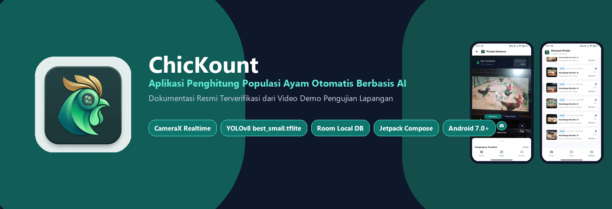
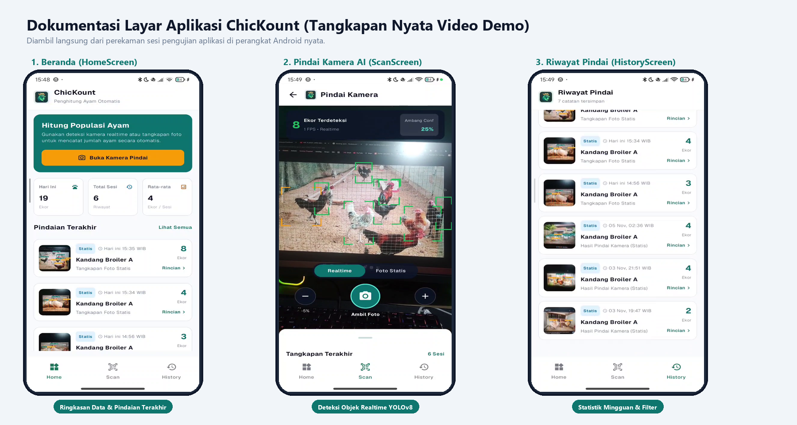
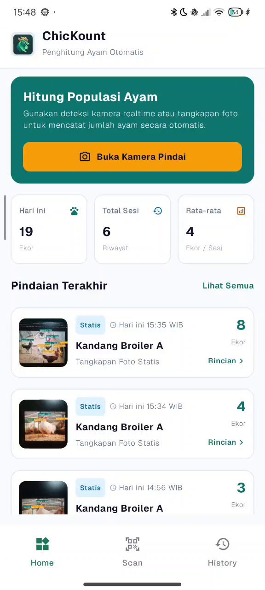
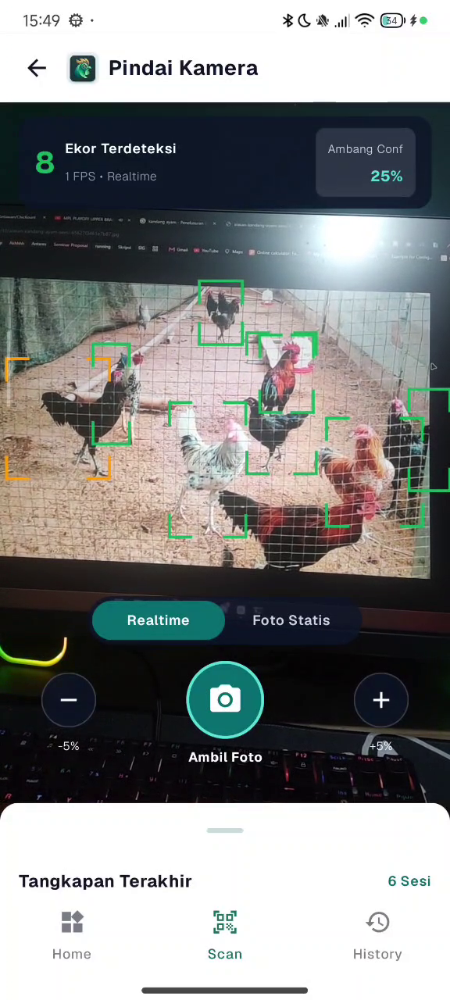
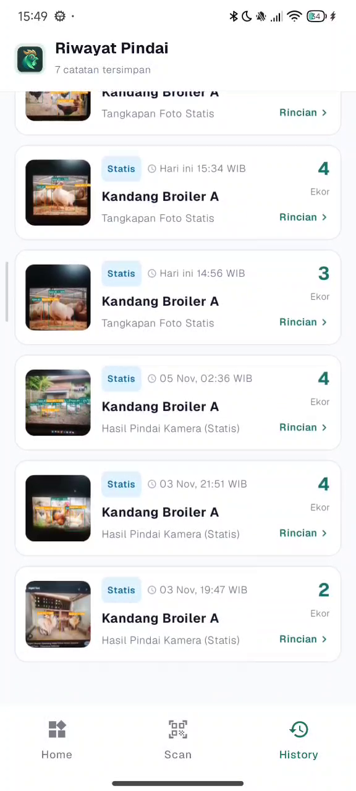
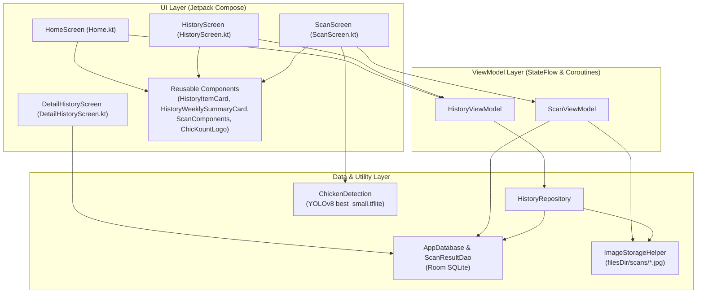

# 🐔 ChicKount — Aplikasi Penghitung Populasi Ayam Otomatis Berbasis AI

**ChicKount** adalah aplikasi Android modern berbasis **Computer Vision (YOLOv8 TensorFlow Lite)** dan **Jetpack Compose** yang dirancang untuk membantu peternak ayam broiler menghitung populasi ayam secara otomatis, akurat, dan *realtime* melalui kamera perangkat maupun tangkapan foto statis. Seluruh hasil pemindaian beserta gambar anotasi *bounding box* disimpan secara permanen di penyimpanan lokal perangkat menggunakan arsitektur **MVVM (Model-View-ViewModel)** dan **Room Database**.

Dokumentasi gambar di bawah ini diambil langsung dari rekaman video pengujian dan demonstrasi aplikasi (*real device demo test*).

---

## 📦 File Instalasi (.APK)

File instalasi aplikasi yang telah di-build tersedia langsung di dalam folder dokumentasi ini:
- **Nama File**: [`ChicKount-v1.0-debug.apk`](ChicKount-v1.0-debug.apk)
- **Lokasi Asli Build**: `app/build/outputs/apk/debug/app-debug.apk`
- **Ukuran File**: ~103 MB (termasuk bobot model neural network YOLOv8 `best_small.tflite` 44.7 MB)
- **Minimum Android SDK**: Android 7.0 (API Level 24) — Target SDK 37

---

## ✨ Fitur Utama

1. **Deteksi Ayam Realtime & Foto Statis (`YOLOv8 TFLite`)**
   - Mendukung pemindaian langsung (*live camera preview*) menggunakan **CameraX** dengan *bounding box* sudut dinamis.
   - Mode inferensi CPU optimal multi-core berbasis **XNNPACK SIMD**, menjaga kestabilan memori dan bebas crash native.
   - Pengaturan **Ambang Sensitivitas (*Confidence Threshold*)** secara langsung (`-5%` / `+5%`) untuk menyesuaikan kondisi pencahayaan dan kepadatan kandang.

2. **Penyimpanan Gambar Anotasi & Database Lokal (`Room SQLite`)**
   - Setiap sesi pindaian yang disimpan akan menggambar kotak deteksi (*bounding box*) beserta label persentase keyakinan langsung ke file gambar (`.jpg`) di penyimpanan internal (`filesDir/scans/`).
   - Fitur **Auto-Sync & Pemulihan Lokal** (`syncAndRestoreLocalScans`) yang otomatis membaca dan memulihkan seluruh foto hasil pindaian dari penyimpanan lokal.

3. **Beranda (*Home*) Berbasis Data Nyata**
   - Kartu aksi cepat (*Hero Card*) menuju kamera pemindai ayam.
   - Ringkasan metrik nyata dari database lokal: **Hari Ini (Ekor)**, **Total Sesi (Riwayat)**, dan **Rata-rata (Ekor / Sesi)**.
   - Daftar **Pindaian Terakhir** yang terhubung langsung dengan Room Database dan dapat diklik untuk membuka rincian.

4. **Riwayat Pemindaian (*History*) & Rincian Sesi (*Detail History*)**
   - Rekapitulasi total ayam terhitung, jumlah sesi pindai, rata-rata per sesi, dan grafik distribusi 7 hari (`Sen` – `Min`).
   - Filter waktu interaktif (**Hari Ini**, **Minggu Ini**, **Semua**) dan tombol pengurutan (**Terbaru** / **Terlama**).
   - Rincian lengkap sesi pemindaian dengan foto resolusi tinggi, waktu pindaian, mode kamera, fitur **Bagikan Laporan**, dan dialog konfirmasi hapus data.

---

## 📱 Dokumentasi Tampilan Aplikasi (Dari Video Demo)

### 1. Pratinjau Antarmuka Layar (*Screens Showcase*)
Perbandingan ketiga layar utama aplikasi **ChicKount** yang diekstrak langsung dari rekaman video demo pengujian:

---

### 2. Tangkapan Layar Nyata (*Actual Device Screenshots*)

Berikut adalah tangkapan layar penuh dari masing-masing fitur aplikasi sebagaimana terlihat pada video demonstrasi:

| 1. Beranda (`HomeScreen`) | 2. Kamera Pindai AI (`ScanScreen`) | 3. Riwayat Pindai (`HistoryScreen`) |
| :---: | :---: | :---: |
|  |  |  |
| *Ringkasan statistik hari ini, rata-rata, dan pindaian terakhir.* | *Kamera live mendeteksi ayam dengan kotak hijau & counter realtime.* | *Statistik total ayam, diagram batang mingguan, filter & daftar sesi.* |

---

## 🏗️ Arsitektur & Struktur Proyek (MVVM)

Aplikasi ini menerapkan pola arsitektur **MVVM (Model - View - ViewModel)** dengan pemisahan tanggung jawab yang bersih (*separation of concerns*):

## 🛠️ Teknologi yang Digunakan

- **Bahasa Pemrograman**: Kotlin 2.2
- **UI Framework**: Jetpack Compose (Material Design 3)
- **Kamera**: AndroidX CameraX (`camera-core`, `camera-camera2`, `camera-lifecycle`, `camera-view` v1.4.1)
- **Machine Learning / AI**: TensorFlow Lite (`org.tensorflow:tensorflow-lite:2.17.0`) dengan format tensor NCHW `[1, 3, 640, 640]` dan algoritma *Non-Maximum Suppression (NMS)*
- **Database Lokal**: AndroidX Room (`room-runtime`, `room-ktx` v2.8.5)
- **Arsitektur**: MVVM dengan Kotlin Coroutines & `StateFlow`
- **Navigasi**: Jetpack Navigation Compose

---

## 🚀 Panduan Instalasi & Menjalankan Aplikasi

1. **Instalasi File APK**:
   - Salin file [`ChicKount-v1.0-debug.apk`](ChicKount-v1.0-debug.apk) ke memori ponsel Android Anda.
   - Ketuk file `.apk` untuk memulai instalasi dan berikan izin *Install Unknown Apps* jika diminta.
   - Buka aplikasi **ChicKount** dan berikan izin akses kamera saat pertama kali membuka fitur Pindai.